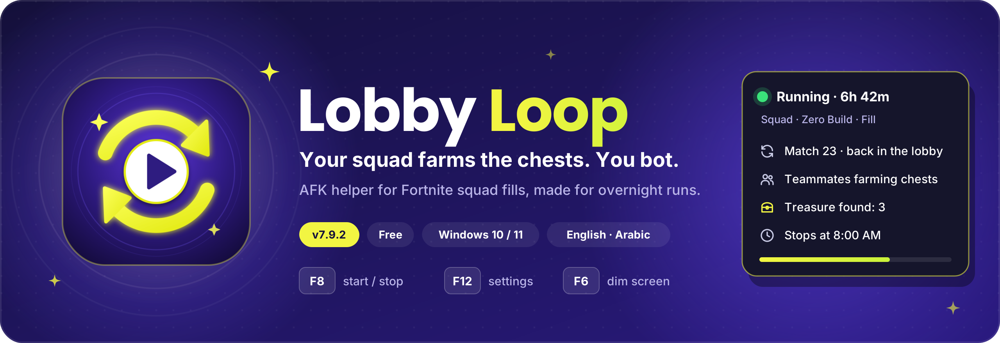

# 📖 Lobby Loop user guide

Everything you need to set up Lobby Loop, use it overnight and control it from your phone.

**Contents**
1. [Install](#1-install)
2. [First run](#2-first-run)
3. [Keys](#3-keys)
4. [A night with Lobby Loop](#4-a-night-with-lobby-loop)
5. [Settings, section by section](#5-settings-section-by-section)
6. [Treasure](#6-treasure)
7. [Discord alerts](#7-discord-alerts)
8. [Phone control (Discord bot)](#8-phone-control-discord-bot)
9. [Remote play (Parsec / AnyDesk)](#9-remote-play-parsec--anydesk)
10. [Before you leave it overnight](#10-before-you-leave-it-overnight)
11. [Troubleshooting](#11-troubleshooting)
12. [Your files, updates and removing it](#12-your-files-updates-and-removing-it)

---

## 1. Install

| Option | What to do |
|---|---|
| **The .exe (easiest)** | Download **`lobby_loop.exe`** from the [latest release](https://github.com/yensobased1/lobby-loop/releases/latest) into a folder of its own (for example `Desktop\Lobby Loop`) and double-click it. No AutoHotkey needed. |
| **The script** | Put `lobby_loop.ahk` and `start_lobby_loop.bat` in one folder and double-click the `.bat`. It installs [AutoHotkey v2](https://www.autohotkey.com/) for you if it's missing. |

> **Windows SmartScreen** may say "Windows protected your PC" the first time, because the .exe isn't code-signed. Click **More info > Run anyway**. Each release lists the file's SHA-256 checksum so you can confirm it's the real one.
>
> **Windows Defender may quarantine it as a trojan.** That's a false positive caused by what Lobby Loop needs to do (Administrator, keyboard hook, hidden PowerShell for screen reading, Discord commands, self-update). See [Antivirus may flag it](README.md#%EF%B8%8F-antivirus-may-flag-it-false-positive) for how to check the file and allow it, or run `lobby_loop.ahk` instead.

Lobby Loop keeps its settings, stats and logs in a **`Lobby Loop data`** folder next to the .exe.

## 2. First run

1. Open Fortnite in **Windowed Fullscreen** (Settings > Display > Window Mode). Lobby Loop warns you if it isn't.
2. Go to the **lobby**.
3. Start Lobby Loop. The **setup wizard** asks for your mode, your name (for Discord and the leaderboard) and, optionally, a Discord link.
4. Press **F8** to start. The **status box** in the corner shows what it's doing.

> Keep Fortnite as the window in front. Lobby Loop pauses when you tab out, and tells you on Discord if it stays paused for 10 minutes.

## 3. Keys

| Key | What it does |
|---|---|
| **F8** | Start / stop (also cancels a shutdown countdown) |
| **F9** | Exit Lobby Loop |
| **F12** | Settings |
| **F11** | Self-test (checks Fortnite, the screen reader, Discord and more) |
| **F6** | Dim the screen (Lobby Loop keeps working underneath) |
| **F10** | Show / hide the status box |
| **F7** | Teach a popup button: hover over it first (Shift+F7 forgets one) |

All keys can be changed in **Settings > Hotkeys**.

## 4. A night with Lobby Loop

**Lobby** (checks your mode) → **Ready up** (squad fill) → **Match** (your team farms chests, you stand still) → **Treasure** (screenshot + claim) → **Play again** → … until your timer.

- In the match it moves a little like a person so you aren't kicked for being idle, and stands still while you spectate teammates.
- After a match it either clicks **Play Again** (faster) or goes **back to the lobby**. Treasure banners and claim screens **only show in the lobby**, so pick *Return to lobby* if you farm treasure.
- When your timer ends it can just stop, close Fortnite, sleep or shut down the PC (30-second countdown, F8 or `!cancel` to stop it).

## 5. Settings, section by section

| Section | What's in it |
|---|---|
| 🎮 **Play** | Profile (Overnight, Quick 1 hour, Chill, Custom), stop timer (`2h`, `90m`, `9:30 PM`), what happens when it stops, *after a match* (Play Again or Return to lobby), match limit, your name, **Overnight treasure farm** one-click preset |
| 🎯 **Mode** | Team size, Build / Zero Build, Fill / No fill, what to do when the lobby mode is wrong, experimental auto-switch |
| 🤝 **Squad fill** | Stand still while spectating, leave when the squad is empty, click reward buttons |
| ⏰ **Schedule** | Start every day at a time, start with Windows, check Fortnite's servers first, fresh restart every few hours (only between matches) |
| ✨ **Extras** | Mute or set Fortnite's volume, dim the screen, keep the PC awake, read placement and XP, FPS saver (30 FPS while running, yours comes back after), laptop battery guard |
| 🏴‍☠️ **Treasure** | The treasure watcher (see [section 6](#6-treasure)) |
| 🎬 **Alerts & clips** | Sound, screenshot and a clip of the 20 seconds before a find |
| ⌨️ **Hotkeys** | Change every key |
| 🧩 **Popups** | Buttons you taught with F7; they're clicked whenever they show up |
| 🔔 **Discord alerts** | Webhook link, screenshots, daily summary, friends leaderboard |
| 📱 **Phone control** | Discord bot, your user ID, **Remote play** |
| 🎨 **Look** | English / العربية, theme, status box size and style |
| 🧹 **Storage** | Where files go, auto-cleanup, log size |
| 🔗 **Share & tools** | Share your setup with a code, report a bug, install / remove |

Type in **Search settings** (bottom left) to jump to any option.

## 6. Treasure

Lobby Loop reads the screen and recognises:

| Category | Examples | Notes |
|---|---|---|
| **Pirate Shop Access** (pirate token) | the gold F-compass | On the match recap it's spotted by its **gold icon** even when there's no name |
| **Gizmos** | Sprite Locator, Lucky Locator | `GIZMO` always counts |
| **Treasure** | the week's prizes (outfits, cars, Jam Tracks…) | Updated online every week from fnchesttracker.com |
| **Your own words** | anything you type | Start a word with `!` to count it without the prize banner |

- **Get the newest words online** keeps the weekly prize names up to date by itself; your own words are kept.
- **Stop after the match when I find…** stops on a Pirate Shop Access, any treasure, or never.
- **Lobby proof** screenshots the prize screen, then clicks **Claim**. Screenshots are saved in `Lobby Loop data\lobby_loop_treasure_proof`.
- **What I own** marks prizes you already have; **Odds** shows how likely each find is.

> Needs **Return to lobby** after a match (Settings > Play), because prize screens only show in the lobby.

## 7. Discord alerts

1. In your Discord server: **Server Settings > Integrations > Webhooks > New Webhook**, pick a channel, **Copy Webhook URL**.
2. Paste it in **Settings > Discord alerts**, click **Save**, then press **F11** (self-test) to check it.

You get: started / stopped, treasure finds with a screenshot, stuck / crashed / paused alerts, a daily summary, a weekly recap and the friends leaderboard. Optional **phone push notifications** go through the free [ntfy](https://ntfy.sh) app: type a topic name in the same section and click **Test push**.

> Keep your webhook link private: anyone with it can post in that channel.

## 8. Phone control (Discord bot)

Control Lobby Loop by typing commands in your Discord channel. Setup takes about 5 minutes (**Settings > Phone control > How do I set this up?**):

1. Create a bot at the [Discord Developer Portal](https://discord.com/developers/applications), turn on **Message Content Intent**, copy the **bot token**.
2. Invite the bot to your server with *Send Messages*, *Read Message History*, *Attach Files* and *Add Reactions*.
3. In Settings paste the **bot token**, the **channel ID** and **your user ID** (right-click yourself > Copy User ID, with Developer Mode on).
4. Type `!ping` in the channel.

> Never share the bot token or paste it anywhere but Lobby Loop's Settings. **Your user ID is required** for the power commands and `!set`, so nobody else can control your PC.

Add a name to target one PC when friends share the channel, e.g. `!stop zen`.

### Run and status
| Command | What it does |
|---|---|
| `!start` / `!stop` | Start or stop |
| `!pause 15` / `!resume` | Pause for 15 minutes (any number), or carry on now |
| `!status` | What it's doing, matches this run, PC time, screen size, locked or not |
| `!ping` | Quick check: version, Fortnite open, current state |
| `!uptime` | How long Lobby Loop and the PC have been on |
| `!timer 2h` / `!timer 9:30pm` / `!timer off` | Set or clear the stop timer |
| `!profile overnight` | Switch profile (`overnight`, `quick`, `chill`, `custom`) |
| `!cancel` | Cancel a sleep / shutdown countdown |

### See the screen
| Command | What it does |
|---|---|
| `!ss` | Screenshot now |
| `!watch 10` / `!watch off` | Screenshot every 10 minutes while running |
| `!live` | One status message that keeps updating |
| `!panel` | A control panel with reaction buttons |
| `!read` | The text Lobby Loop sees on screen right now |
| `!log` | The latest log lines |

### Stats
| Command | What it does |
|---|---|
| `!stats` | All-time matches, hours, XP, best place, treasures |
| `!week` / `!summary` / `!recap` | Last 7 days / today / the weekly recap |
| `!last` | The last match |
| `!treasures` | Treasure count and the last find |
| `!prizes` | This week's prizes and which you own |
| `!lb` | Friends leaderboard |
| `!teammates` | Teammate stats |

### Game and screen
| Command | What it does |
|---|---|
| `!mode` | The mode you want vs the mode the lobby shows |
| `!mode zerobuild squad fill` / `!mode any` | Change the mode |
| `!servers` | Are Fortnite's servers up (status.epicgames.com) |
| `!dim` / `!mute` / `!unmute` / `!overlay` | Dim screen, mute Fortnite, show / hide the status box |
| `!popups` | How many popup buttons it has learned |
| `!clip` | Press your clip key now |
| `!focus` | Bring Fortnite to the front |
| `!keys` | Let go of every stuck key and mouse button |
| `!remote on` / `!remote off` | Remote play on or off |

### Settings from your phone (`!set`, needs your user ID)
`!set mode zerobuild squad fill` · `!set stop 8am` / `2h` / `off` · `!set profile overnight` · `!set after lobby` / `playagain` · `!set limit 20` · `!set restart 6` · `!set volume 30` · `!set mute on` · `!set dim on` · `!set fps on` · `!set screen 2` · `!set treasure on` · `!set stopfind token` / `any` / `off` · `!set clip on` · `!set fill on` · `!set squadcheck on` · `!set recap on` · `!set remote on`

Type `!set` alone to see the list.

### Power (needs your user ID)
| Command | What it does |
|---|---|
| `!update` | Install the newest version; it carries on running after |
| `!reload` | Restart Lobby Loop; it carries on running after |
| `!restartgame` / `!closegame` | Restart or close Fortnite |
| `!sleep` / `!shutdown` | Sleep or shut down the PC after 30 s (`!cancel` stops it) |

## 9. Remote play (Parsec / AnyDesk)

Turn it on in **Settings > Phone control > Remote play** (or `!remote on`), then restart Lobby Loop.

**You touch your phone screen** → **the mouse moves on the PC** → **Lobby Loop lets go of every key and waits** → **you play or fix something** → **60 s without mouse movement** → **it carries on by itself**

- The status box is visible in Parsec / AnyDesk, even if it's hidden from streams.
- If Fortnite loses focus for 90 s (for example after you close Parsec), it's brought back to the front.
- **Always on, even without remote play:** a Discord alert if the PC gets **locked** (Lobby Loop waits and carries on after unlocking) or the **screen size changes**.

**Before you travel**
- AnyDesk: turn off **Lock account on session end**.
- Parsec: set resolution to **Keep host resolution** and turn off **Lock on disconnect**.
- Windows: sleep **Never** when plugged in.

> During a match Fortnite keeps the cursor in the middle, so taking over isn't noticed. Send `!pause 10` first if you want to play.

## 10. Before you leave it overnight

- [ ] Fortnite in **Windowed Fullscreen**, in the lobby, mode set
- [ ] **F11 self-test** all green
- [ ] Stop timer and stop action set (Settings > Play)
- [ ] *After a match: Return to lobby* if you farm treasure
- [ ] Discord alerts work (`!ping` answers)
- [ ] PC won't sleep (Keep the PC awake is on)
- [ ] Laptop: plugged in, or battery guard on

Or click **Overnight treasure farm** in Settings > Play to set the usual options in one go.

## 11. Troubleshooting

| Problem | Fix |
|---|---|
| **Status says "Paused: click into Fortnite"** | Fortnite isn't the window in front. Click into it or send `!focus`. After 10 min you get an alert; after 20 min with nobody at the PC it fixes itself. |
| **It doesn't click Ready / Play** | Use **Windowed Fullscreen**, keep the game language the same as Lobby Loop's, run **F11** and look at the text-reader row. |
| **Wrong mode** | Check Settings > Mode, or `!mode` to see what the lobby shows. |
| **A popup blocks it** | Hover over the popup's button and press **F7**; it'll be clicked from then on. |
| **Treasure isn't detected** | Treasure watcher on, *Return to lobby* after a match, and *Get the newest words online* on. Use `!read` to see what Lobby Loop reads. |
| **Phone commands don't answer** | Bot token, channel ID and user ID all filled in (Settings > Phone control); the bot needs **Message Content Intent**. Lobby Loop warns at start if the token is missing. |
| **"Safe mode" at start** | Lobby Loop didn't close properly last time. A few features are off until you restart it. |
| **Windows says the file is unsafe** | It's unsigned, see [Install](#1-install). Compare the SHA-256 on the release page. |
| **Windows Defender quarantined it as a trojan** | False positive. Compare the SHA-256 with the release page, then Windows Security > Protection history > the entry > **Actions > Allow on device**. Or run `lobby_loop.ahk` instead. Details in the [README](README.md#%EF%B8%8F-antivirus-may-flag-it-false-positive). |
| **Something else** | Settings > Share & tools > **Report a bug** collects the log and a screenshot. |

## 12. Your files, updates and removing it

| File in `Lobby Loop data` | What it is |
|---|---|
| `lobby_loop_settings.ini` | Your settings (contains your Discord links and bot token: don't share it) |
| `lobby_loop_stats.ini` | Totals, owned prizes, weekly prizes |
| `lobby_loop_matches.csv`, `lobby_loop_history.csv` | Every match and every session (opens in Excel) |
| `lobby_loop_treasure.csv` + `lobby_loop_treasure_proof\` | Treasure finds and their screenshots |
| `lobby_loop.log` | What happened, for bug reports |

- **Updates:** Lobby Loop checks this repo at start. You get a notification (and a Discord message); install with tray menu > *Check for updates* or `!update`. It keeps running after.
- **Remove:** Settings > Share & tools > **Uninstall**. It removes the shortcuts and Start with Windows, and asks before deleting your data.

---

⚠️ Unofficial, not affiliated with Epic Games. Automation may break Epic's rules; use it at your own risk.
