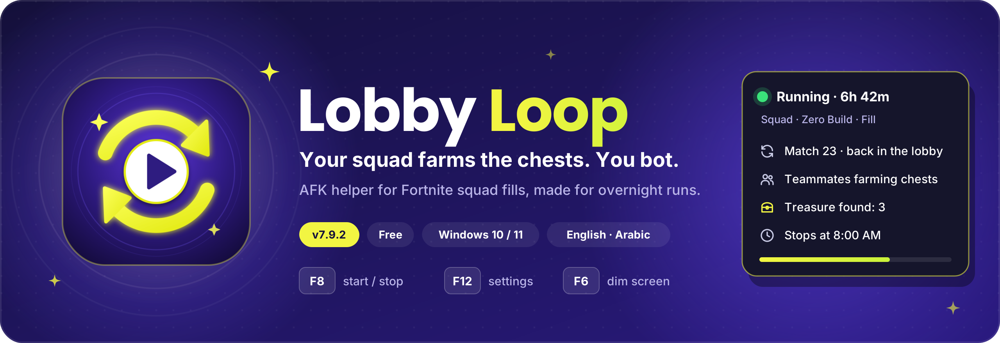
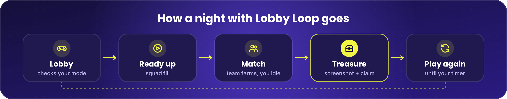
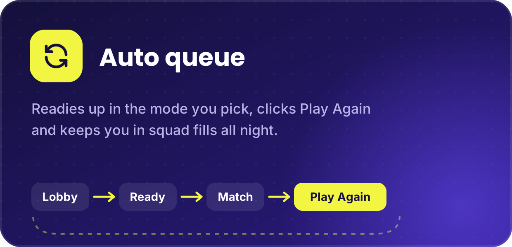
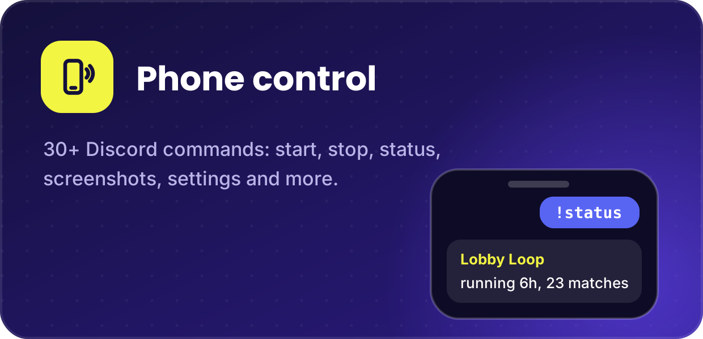
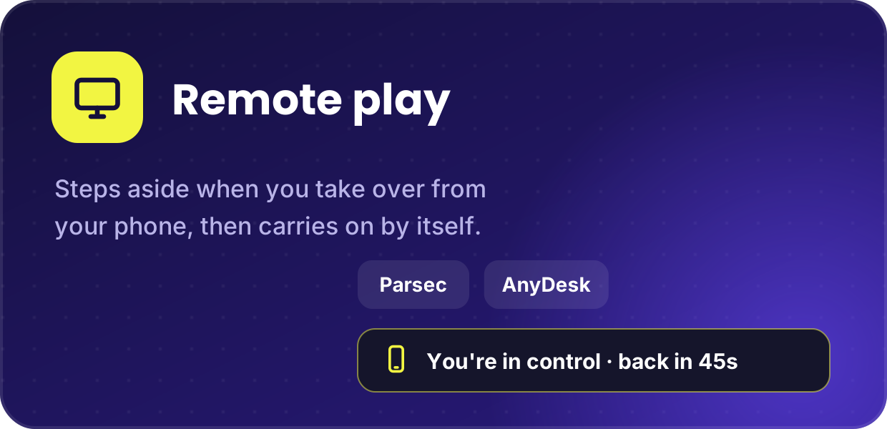
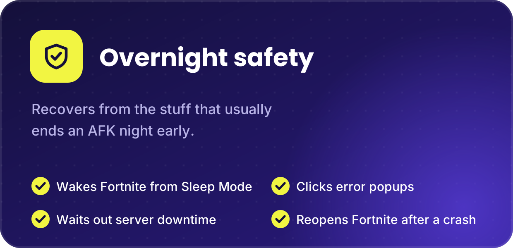
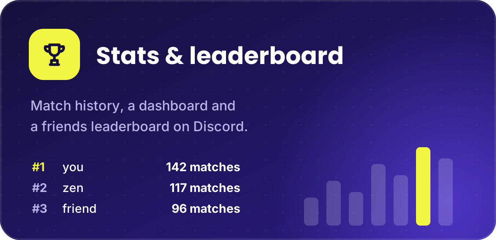

  <a href="https://github.com/yensobased1/lobby-loop/releases/latest"><b>⬇️ Download the latest release</b></a> &nbsp;·&nbsp; <a href="GUIDE.md"><b>📖 User guide</b></a>

# 🔁 Lobby Loop

**Set-and-forget AFK (Away From Keyboard) helper for Fortnite squad fills.** Your teammates farm chests for you while you bot: Lobby Loop readies up in the mode you pick, clicks Play Again, moves like a person, spots treasure and stops on a timer.

<table>
  <tr>
    <td width="50%"></td>
    <td width="50%"></td>
  </tr>
  <tr>
    <td></td>
    <td></td>
  </tr>
  <tr>
    <td></td>
    <td></td>
  </tr>
</table>

## ✨ Features
- 🔁 **Auto queue:** clicks Ready / Play and Play Again by itself (16:9, 16:10 and 21:9 screens)
- 🎯 **Mode check:** Solo / Duo / Trio / Squad, Build / Zero Build, Fill / No fill, checked before every Ready
- 🤝 **Squad fill:** stops moving while you spectate teammates and clicks reward buttons by itself
- 🏴‍☠️ **Treasure watcher:** Sprite gizmos, weekly treasure cosmetics, pirate tokens, with a sound, a screenshot and a clip of the 20 seconds before
- ⚙️ **Extras:** stop after X matches, keep the PC awake, Fortnite volume, hide the status box from streams
- 🛡️ **Overnight safety:** wakes Fortnite from Sleep Mode, clicks known error popups, checks Fortnite's servers before reopening it, FPS (frames per second) saver, laptop battery guard
- 🌐 **Online treasure words:** weekly prize names come from [`treasure_words.txt`](treasure_words.txt), so they update without a new version
- 🚶 **Human-like movement:** walks, sprints, slides, crouches, strafes, jumps, dives, swaps weapons and looks around
- 🧙 **Setup wizard** and **profiles** (Overnight, Quick 1 hour, Chill)
- 🌍 **English / العربية**
- ⏰ **Schedule:** start every day at a set time, stop after X hours or at a clock time
- 💤 **When it stops:** just stop, close Fortnite, sleep or shut down the PC (30-second countdown, cancellable)
- 🌙 **Dim screen** and **mute Fortnite** while it runs
- 🛟 **Self-recovery:** clicks popups you teach it (F7), reopens Fortnite after a crash, gets itself unstuck
- 📊 **Stats:** reads your placement and XP, history in Excel, and a stats dashboard with charts
- 🔔 **Discord:** alerts, screenshots, daily summary, friends leaderboard
- 📱 **Phone control** with a Discord bot: `!start` `!stop` `!status` `!ss` `!log` `!lb` `!summary` `!dim` `!focus` `!set` and more (`!help`)
- 🖥️ **Remote play:** steps aside when you take over with Parsec or AnyDesk from your phone, and warns you if the PC gets locked
- ⬆️ **Auto-updates** from this repo, and **Start with Windows**

## 🚀 How to use
1. Download **`lobby_loop.exe`** (no AutoHotkey needed). Using the `.ahk` instead? Put **`start_lobby_loop.bat`** next to it and double-click that: it installs [AutoHotkey v2](https://www.autohotkey.com/) for you if it's missing.
2. Open Fortnite in **Windowed Fullscreen** and go to the lobby.
3. Double-click Lobby Loop and click **Yes**.
4. Press **F12** to set the timer (optional), then **F8** to start.

| Key | Action |
|---|---|
| **F8** | Start / Stop (also cancels the shutdown countdown) |
| **F9** | Exit |
| **F11** | Self-test |
| **F12** | Settings |
| **F7** | Teach a popup button (hover over it first) |
| **F6** | Dim screen |
| **F10** | Show / hide the status box |

Keep Fortnite as the active window: it pauses when you tab out.

📖 **Full setup, every phone command and troubleshooting: [GUIDE.md](GUIDE.md)**

## 🛡️ Antivirus may flag it (false positive)
**Windows Defender or other antivirus may detect `lobby_loop.exe` as a trojan** (for example *"This program is dangerous and executes commands from an attacker"*) and quarantine it. It's a false positive: Lobby Loop is open source, and every line of it is in this repo.

**Why it happens:** to do its job, Lobby Loop does things that malware also does:
- runs as **Administrator** and uses a **keyboard hook** (to press keys in Fortnite)
- reads the screen with Windows' text reader through **hidden PowerShell**
- takes **commands from Discord** (phone control)
- **downloads its own updates** and can add a **startup shortcut**

**What you can do:**
1. **Check it's the real file:** compare its SHA-256 with the checksum on the [release page](https://github.com/yensobased1/lobby-loop/releases/latest). Each release also links its VirusTotal scan.
2. **Allow it:** Windows Security > Virus & threat protection > **Protection history** > the Lobby Loop entry > **Actions > Allow on device**.
3. **Or run the script instead of the .exe:** `lobby_loop.ahk` with `start_lobby_loop.bat` (installs AutoHotkey if needed). Scripts are flagged far less often.
4. **Help get it whitelisted:** report it to Microsoft at [microsoft.com/wdsi/filesubmission](https://www.microsoft.com/en-us/wdsi/filesubmission) as *Incorrectly detected*.

> Only allow a file you downloaded from this repo's releases. If you got it anywhere else, delete it.

## ⚠️ Disclaimer
Unofficial and not affiliated with Epic Games. Automation may break Epic's rules, so use it at your own risk.
